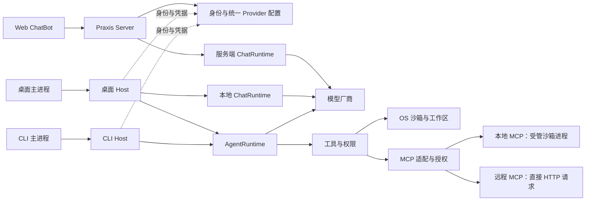

# 知行 Praxis 设计文档

更新：2026-11-03（核心设计延续 2026-11-02 批次的文件名）。当前已形成第一版核心模块、MCP、UI 基线及开发计划，尚未创建应用代码或完成真实平台验证。用户明确决定见[总体设计 D01–D18](superpowers/specs/2026-11-02-praxis-design.md#2-已确认的决定)；其余具体接口、默认值和技术选型作为实施起点，在开发中验证和调整。未展开的后续能力在第 4 节列出。

## 1. 阅读入口与模块覆盖

| 文档 | 解决的问题 |
| --- | --- |
| [总体设计](superpowers/specs/2026-11-02-praxis-design.md) | 产品边界、三端职责、部署、已确认决定及 V01–V32 验收 |
| [执行核心、Session 与持久化](superpowers/specs/2026-11-02-praxis-runtime-session-design.md) | 输入接纳、queue/steer、Turn/Step、预算、事件、表结构、checkpoint、恢复/迁移/删除 |
| [上下文与压缩](superpowers/specs/2026-11-02-praxis-context-design.md) | 提示词、AGENTS.md、Token 算法、协议分组、摘要结构、连续压缩、失败提交 |
| [内置工具](superpowers/specs/2026-11-02-praxis-tools-design.md) | 13 个工具的参数/结果、文件版本、命令生命周期、计划/提问、产物、T01–T15 验收 |
| [模型、认证与凭据](superpowers/specs/2026-11-02-praxis-model-auth-design.md) | 统一 Provider、DeepSeek、流协议、重试、登录/API Key、加密与直连密钥交付 |
| [Host 协议与 ChatRuntime](superpowers/specs/2026-11-02-praxis-protocol-chat-design.md) | stdio/HTTP/SSE、方法、版本、事件重放、背压、多轮/重生成、关闭与取消 |
| [插件、工作区与配置](superpowers/specs/2026-11-02-praxis-plugins-config-design.md) | SDK、Manifest、激活/停用、可信边界、项目身份/占用、配置来源、生效版本、平台迁移 |
| [系统沙箱与交付](superpowers/specs/2026-11-02-praxis-sandbox-delivery-design.md) | 三 OS 后端合同、网络/文件/进程限制、诊断、保留、部署、测试矩阵、升级 |
| [MCP 接入与上下文](superpowers/specs/2026-11-02-praxis-mcp-design.md) | 配置、2026/2025 协议、stdio/HTTP、工具发现/按需加载、资源、用户模板、MRTR、能力限制 |
| [MCP 安全与运行保障](superpowers/specs/2026-11-02-praxis-mcp-security-design.md) | 沙箱/执行位、OAuth/秘密、审批、取消/未知效果、事件/恢复、控制 API、M01–M20 验收 |
| [三项目参考分析](superpowers/specs/2026-11-02-praxis-reference-analysis.md) | DSH / OpenCode 源码版本、Codex 官方资料、借鉴与刻意保留的产品差异 |
| [UI 设计基线](superpowers/specs/2026-11-03-praxis-ui-design.md) | ChatGPT/Codex 参考、三端布局、对话/执行/审批/恢复交互、设置与可访问性 |
| [开发计划](superpowers/plans/2026-11-03-praxis-development-plan.md) | P0–P7 里程碑、第一个开发切片、检查与本机 Git 身份提交节奏 |

## 2. 运行关系

图中的 AgentRuntime 表示共用代码，不表示桌面和 CLI 共用进程或会话。Web 历史在服务端；桌面 Chat/Agent 和 CLI Agent 历史分别在自己的本地存储。桌面与 CLI 直接向模型厂商发送推理请求。

## 3. 已形成的设计闭环

用户输入先持久化，再由唯一 Session 执行者领取；模型输出完整后才执行工具，外部效果与数据库事务之间的未知状态明确记录。退出停止任务，恢复只重建状态，由用户显式继续。

压缩只改变 Context View。原始 Session 事件、摘要版本、具体请求快照和恢复 checkpoint 分开保存；有损摘要不等于历史删除，也不等于副作用可以回滚。

ChatBot 在服务端或本地都没有操作工具。统一配置只填写一份厂商 Key；本地 Host 每个新 turn 取当前版本后直连，活动 turn 使用固定快照，退出不留下运行服务。

工具执行由 Host 策略、用户单次授权和实际 OS 限制共同决定。可信插件同进程运行，不冒充恶意代码隔离；原生沙箱不可用时拒绝对应命令。

MCP 现在有完整的接入闭环设计：13 个核心工具之外增加 3 个条件桥接工具和按需动态工具；资源作为有来源的材料、提示词由用户选择。stdio 按操作回收并占用文件执行位；远程请求取消后不谎称外部效果已撤销。MCP 不进入 ChatBot。

## 4. 设计评审与实现验证

当前仍属实现提案的主要细节包括：桌面 ChatRuntime 的本地部署、管理员创建账号、每轮在线取配置、关闭最后窗口即退出、turn 结束停止命令、默认禁用命令网络、完全访问入口默认关闭，以及各项有界预算。MCP 另有按操作回收 stdio、双版本兼容、本地 OAuth 存储和受限能力集等提案。可以据此开始开发并结合证据修订，无需重新讨论已确认的 D01–D18；候选后端与默认值不等于已经验证的能力。

| 设计状态 | 覆盖范围 |
| --- | --- |
| 已有详细合同或实施基线 | 第一版执行/Session/上下文、模型/认证、Chat/协议、工具/权限、插件/配置/工作区、沙箱/交付、MCP 接入与运行保障、UI 与开发里程碑 |
| 有明确不支持行为 | MCP sampling、Tasks、Apps、URL elicitation、现代 roots 默认关闭、跨调用 stdio 内存状态；不声明这些能力，必要时给出兼容性错误 |
| 仍属于后续独立设计 | 原生图像/音频、Web 搜索/浏览器、LSP、Skills、子 Agent、复杂分支、多端控制租约/租户平台；MCP 接入不等于这些产品能力都已完成设计 |

实施从工程基座与最小 CLI/Host 协议开始；可注入 Fake Provider 的执行核心、UI 组件与三平台原生验证可以并行。真实命令和 MCP stdio 开放前必须通过对应系统的隔离与退出清理验证，尤其 Windows AppContainer 工具链兼容、macOS 进程逃逸阻断和 Linux namespace 可用性。后续按开发计划接入模型、身份、客户端和 MCP；里程碑不是实施已完成声明。

当前已初始化独立 Git 仓库并保存设计基线，沿用本机作者与提交者身份。本阶段仅有设计和工程说明；未运行真实模型、未使用用户 API Key、未安装依赖、未创建客户端代码。UI 组件与实际页面的视觉/交互验证将在实现阶段完成。
